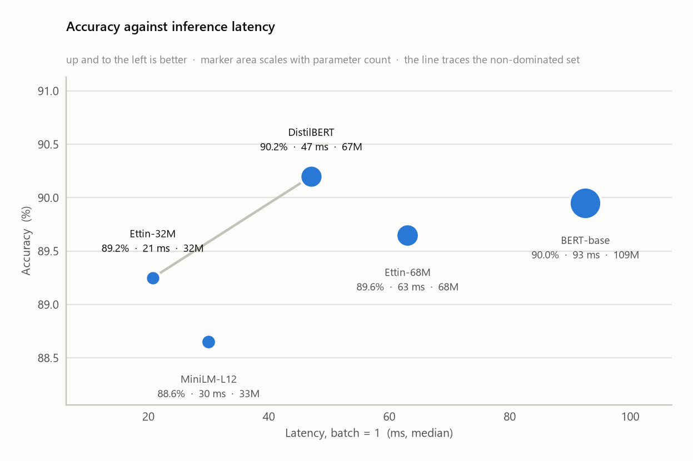
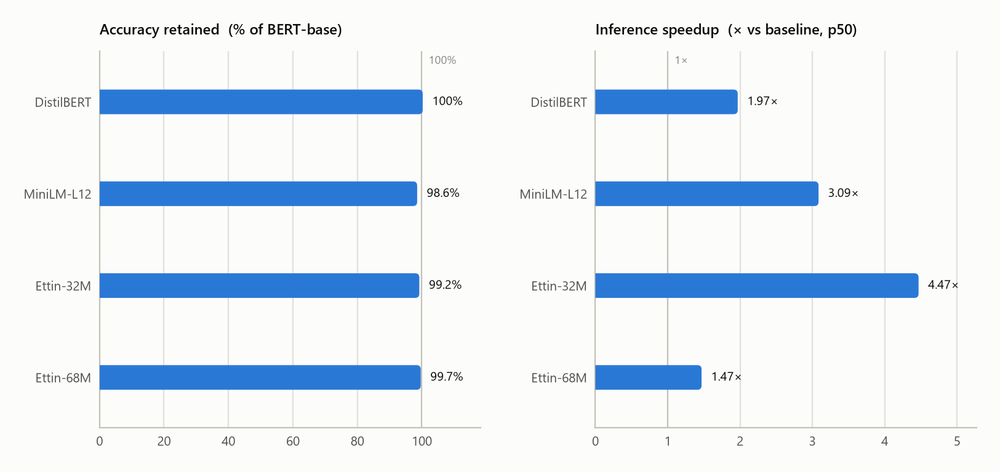
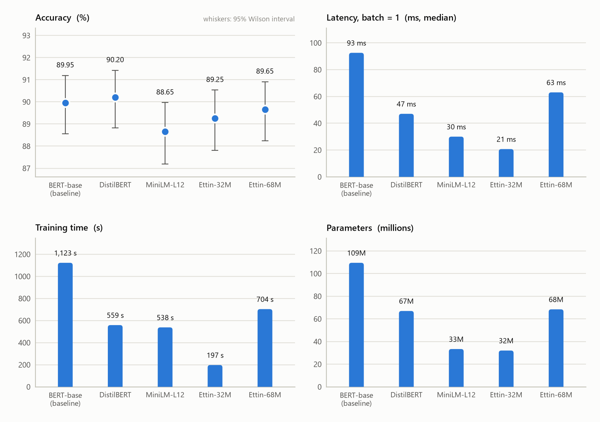

# How much performance do you lose by using smaller Transformers?

[](https://github.com/eigenthingy/Transformer-Efficiency-Benchmark/actions/workflows/selftest.yml)

A controlled benchmark of Hugging Face encoders — 4M to 395M parameters, spanning eight different
routes to a cheaper model — fine-tuned on the same task, on the same data, with the same
protocol, and measured on five axes: accuracy, training time, inference latency, model size and
parameter count.

The output is not a leaderboard. It is an **exchange rate**: how many points of accuracy you
surrender per unit of speed you buy. That number is what an engineering decision actually
turns on, and it is the thing most model comparisons leave out.

Two things separate this from the many benchmarks of the same models, and neither is the model
list:

- **No gap is called a difference until it survives a paired significance test.** Accuracy is an
  estimate from a sample; the repo reports its interval and refuses to rank inside the noise.
- **The instrument is validated, not assumed.** Three defects in the timing protocol were found
  by controls built into the harness, each having first produced entirely plausible numbers.
  They are documented in [Measurement notes](#measurement-notes--what-went-wrong-and-how-it-was-caught).

```
DistilBERT preserves X% of BERT-base's accuracy
  (Δ = −a.bc pp, 95% CI [−x, +y] pp; McNemar p = 0.nnn)
while cutting p50 inference latency by Y% (Z× faster) and parameters by W%.
```

`report.py` fills that sentence in with your measured numbers and writes it to
[`results/benchmark.md`](results/benchmark.md).

---

## Why smaller models still matter

The reflex answer is "because they are cheaper," which is true and not very interesting. Four
sharper reasons:

**1. Latency is a product constraint, not a preference.** A search-as-you-type box has a budget
of tens of milliseconds. A moderation filter in a message send path has less. No amount of
accuracy rescues a model that misses the budget — it simply does not ship. Below the budget,
accuracy is what you optimise; above it, latency is the only number that matters. This is a
constraint, not a trade-off, and it is why the frontier in this benchmark is drawn on the
latency axis.

**2. The accuracy gap is usually smaller than the cost gap.** Distillation was designed to
exploit the fact that a fine-tuned encoder is heavily over-parameterised for a single
downstream task. When halving the compute costs you a fraction of a point, the comparison is
not close — and if the remaining gap is inside the confidence interval of your own eval set,
you cannot even measure what you are paying for. Hence the McNemar column: this repo insists
on knowing whether a gap is real before pricing it.

**3. Iteration speed compounds.** A model that trains in a third of the time gets three times
the hyper-parameter search, three times the ablations, three times the error analysis, for the
same wall clock. On a laptop CPU or a single small GPU — the situation most practitioners are
actually in — that ratio is the difference between a project you can iterate on and one you
run once and hope. The `train_time` column is not bookkeeping; it is a measure of how fast you
can learn about your own problem.

**4. Cheap inference changes what you are willing to build.** At 5 ms per document you score
the whole corpus, run the classifier on every candidate instead of a shortlist, ensemble it,
re-run it nightly as the data drifts. At 200 ms you sample. Some designs only exist below a
price point, so the speed column decides architecture, not just cost.

The honest counterweight: none of this says small models are always right. Compression costs
the most on exactly the tasks where headroom is largest — multi-sentence reasoning, NLI, QA,
low-resource languages, long documents. This benchmark is built to *measure* the cost on your
task rather than assume it in either direction, which is why the baseline is always run and
every relative figure is reported against it.

---

## What is measured, and why

| Measurement | Definition | Why this one |
|:---|:---|:---|
| **Accuracy** | Top-1 on a held-out subset, with a 95% Wilson interval | The interval is the point — a ranking without one is not evidence |
| **Macro-F1** | Unweighted mean per-class F1 | Catches a model that wins accuracy by neglecting a small class |
| **Training time** | Wall clock around `Trainer.train()`, evaluation excluded | Iteration speed; excluded eval so the number means one thing |
| **Latency, batch = 1** | Median and p95 ms per forward pass, post-warmup | What an interactive request waits for. p95 because tail latency is what breaks budgets |
| **Throughput, batch = 32** | Examples/second sustained | What offline scoring is billed in — a different question from latency |
| **Parameters** | Total, and **non-embedding** separately | BERT-base and DistilBERT carry an identical ~23.8M of embeddings (tokens plus positions). "Half the parameters" is really "half the *encoder*". Only the non-embedding count tracks latency |
| **Size on disk** | MB of saved weights | Deployment: container size, cold-start, edge budgets |
| **Retention** | accuracy ÷ baseline accuracy | Transfers across hardware, unlike any absolute time |
| **Exchange rate** | accuracy points lost per additional × of speed | The decision variable |

---

## Results

The committed run is the `modern` sweep on AG News (4,000 train / 2,000 eval examples, 128
tokens, seed 42), on one machine: an AMD x86-64 desktop CPU with 24 logical cores, torch
2.13 (CPU build) pinned to 12 threads, no GPU. The full analysis, with intervals and tests, is in
[`results/benchmark.md`](results/benchmark.md); `report.py` regenerates it, and the table below
is copied from it.

| Model | Accuracy | Train time | Inference (p50) | Params | Size |
|:---|---:|---:|---:|---:|---:|
| BERT-base *(baseline)* | 89.95% | 19 min | 92.6 ms | 109.5 M | 418 MB |
| DistilBERT | 90.20% | 9.3 min | 47.0 ms | 67.0 M | 255 MB |
| MiniLM-L12 | 88.65% | 9.0 min | 30.0 ms | 33.4 M | 127 MB |
| Ettin-32M | 89.25% | 3.3 min | 20.7 ms | 32.0 M | 122 MB |
| Ettin-68M | 89.65% | 12 min | 63.1 ms | 68.4 M | 261 MB |

What the run supports:

- **Only one accuracy gap is detectable.** MiniLM-L12 is 1.30 pp below BERT-base (95% CI
  [−2.20, −0.45], McNemar p = 0.005). Every other model's difference from the baseline is
  inside the noise of a 2,000-example eval set, DistilBERT's +0.25 pp included.
- **The speed gaps are large and stable.** They hold across the three interleaved timing rounds:
  the widest per-model range is BERT-base's, 84–93 ms.
- **Ettin-32M is the pick** on this task and machine: 4.5× faster than BERT-base with no
  detectable accuracy loss. It also answers the repo's sharpest question. At the same width as
  MiniLM-L12 it is 1.45× faster, with an accuracy difference that is not significant
  (p = 0.29).
- **Same parameter budget does not mean same speed.** Ettin-68M and DistilBERT have the same
  non-embedding parameter count (42.6 M vs 43.1 M), yet the deep, narrow Ettin-68M (19 × 512)
  is 34% slower than the shallow, wide DistilBERT (6 × 768) on this CPU.

Parameter counts are fixed by the architectures. Everything else was measured on the machine
above; the next section explains why that matters.

### Why these results depend on the machine

Accuracy is a property of the weights. Time is a property of the weights *and the hardware
running them*, and the dependence goes further than "a faster machine gives smaller numbers".

**Absolute times do not transfer at all.** A forward pass on CPU is a sequence of matrix
multiplications whose speed depends on:

- the vector instruction set (AVX2, AVX-512, AMX);
- the core count and clock, which itself moves with temperature and power profile;
- the cache sizes and memory bandwidth;
- the math library torch was built against (oneDNN/MKL on x86, Accelerate on Apple silicon,
  OpenBLAS elsewhere);
- the torch version.

Two machines can easily differ by several times on the same model. The milliseconds and minutes in the
tables describe this machine only.

**The ratios transfer better, but not perfectly.** Speedups are reported relative to the
baseline so that most of the machine cancels out. Not all of it does, because models do not
spend their time on the same things:

- *Fixed overhead weighs more on small models.* Each layer costs Python dispatch, kernel launch
  and memory traffic regardless of its width. On a faster machine the arithmetic shrinks but
  the overhead shrinks less, so a small model's speedup over BERT-base usually *falls*. The 4.5×
  measured here could be 3× elsewhere.
- *Depth and width are priced differently by different hardware.* Layers run one after
  another, while width is parallel work. A GPU or a wide CPU makes width almost free and leaves
  depth expensive; a narrow CPU does the reverse. Deep, narrow models (MiniLM-L12, Ettin-68M)
  and shallow, wide ones (DistilBERT) can therefore **swap places** between machines. The
  Ettin-68M vs DistilBERT comparison above is the case most exposed to this.
- *Thread scaling is uneven.* At batch size 1, a 384-wide matrix gives 12 threads little to
  share, so small models gain less from more cores than large ones do.
- *Batch size changes the multipliers.* Here Ettin-32M is 4.5× faster than BERT-base at batch 1
  but 4.8× at batch 32. The order happens to be the same at both batch sizes on this CPU; on a
  GPU, where batching is far more effective, it need not be.

**Accuracy moves a little too.** Evaluating a given checkpoint is deterministic. But training
on another machine or torch version changes the order of floating-point additions, so the
fine-tuned weights, and therefore the accuracy, differ by a few tenths of a point. That is the
same order as the seed-to-seed variance and the smaller gaps above. This is why the report
tests gaps rather than ranking point estimates.

**What to rely on:**

- Retention, and whether a gap is significant, transfer well.
- Coarse speed ordering transfers well when costs differ by 2× or more.
- Exact speedup multipliers transfer less well.
- The ordering of models with similar costs but different shapes transfers least.

To know the answer for your own deployment, run the sweep on that hardware.
`results/environment.json` records everything needed to compare two runs.

<picture>
  <source media="(prefers-color-scheme: dark)" srcset="plots/accuracy_vs_latency-dark.png">
  
</picture>

<picture>
  <source media="(prefers-color-scheme: dark)" srcset="plots/retention_vs_speedup-dark.png">
  
</picture>

<picture>
  <source media="(prefers-color-scheme: dark)" srcset="plots/cost_panels-dark.png">
  
</picture>

---

## Quickstart

With [uv](https://docs.astral.sh/uv/) — one command, no activation, same versions on every
machine:

```bash
git clone https://github.com/eigenthingy/Transformer-Efficiency-Benchmark.git && cd Transformer-Efficiency-Benchmark

uv sync                                        # builds .venv from uv.lock
uv run python check_env.py                     # what will be measured, and how to size the run
uv run python run_benchmark.py --smoke         # ~5 min on CPU: proves the pipeline end to end (writes to results/smoke/)
uv run python run_benchmark.py --num-threads 12   # the real sweep
```

`uv run` uses the project environment whether or not it is activated, so nothing has to be
sourced — which also sidesteps PowerShell's execution policy on Windows.

[`pyproject.toml`](pyproject.toml) is the source of truth and `uv.lock` pins the exact
resolution. Two choices are encoded there and worth knowing about:

- **torch comes from PyTorch's CPU index**, not PyPI. The output of this repo is timings, and
  timings are meaningless if the build underneath them varies by platform. CPU is deliberate:
  the premise is the GPU-poor setting, and the wheel is smaller with no CUDA init overhead.
  On a CUDA machine, point `[[tool.uv.index]]` at `…/whl/cu124` and re-run `uv sync`.
- **`transformers` is capped below 5.** The repo drives `Trainer` / `TrainingArguments`
  directly, the surface most exposed to a major bump. Raise the cap once a 5.x run is green.

<details>
<summary><b>Without uv</b></summary>

```bash
# Windows
.\setup.ps1
# macOS / Linux
./setup.sh
```

`setup` builds `.venv` and installs [`requirements.txt`](requirements.txt) — loose ranges,
resolved fresh, so not reproducible the way `uv.lock` is. By default the venv inherits your
existing site-packages so an already-installed `torch` is reused rather than downloaded again;
pass `-Isolated` / `--isolated` for a self-contained environment.

On Windows the default execution policy is `Restricted`, which blocks both `setup.ps1` and
`Activate.ps1` (check with `Get-ExecutionPolicy -List`). Either allow local scripts once with
`Set-ExecutionPolicy -Scope CurrentUser RemoteSigned`, or skip the scripts and drive the
interpreter directly:

```powershell
python -m venv --system-site-packages .venv
.\.venv\Scripts\python.exe -m pip install -r requirements.txt
.\.venv\Scripts\python.exe check_env.py
```

Note that a bare `python` on Windows often resolves to the Microsoft Store stub, which is not an
interpreter. `setup.ps1` detects that; if you call `venv` by hand, give the full path to a real
`python.exe`.

</details>

The notebook needs one extra group: `uv sync --extra notebook`.

`--smoke` uses 200 train / 200 eval examples. Its accuracy numbers are meaningless; its purpose
is to fail fast if anything is misconfigured, and to give you a real samples/s figure for your
machine before you commit to the full run. Everything it writes goes under `results/smoke/`
(gitignored), so it never touches the results of a real run.

Pin `--num-threads` on CPU — `check_env.py` prints the right value for your machine. Timings
measured while the thread count floats with system load are not comparable between models, which
is the whole point of the exercise.

### How long it takes

Dominated by training, and within training by the baseline. On CPU, budget **1 to 1.5 hours** for
the default 3-model sweep on a recent desktop processor, and several hours on an older laptop;
on a GPU it is 10–25 minutes. Add ~1 GB of model weights on the first run.

BERT-base is roughly half the total, so the marginal cost of *adding* a small model is low — which
is itself one of the findings. `train.py` reuses any checkpoint trained with the same settings,
so the sweep can be run in pieces and resumed. `--max-train-samples 2000` halves it; `--max-length 64`
cuts most of the remainder.

### Running the stages separately

```bash
python train.py                     # fine-tune, time it, save checkpoints
python evaluate.py                  # accuracy + latency + throughput
python report.py                    # tables, figures, written analysis
```

`train.py` skips a model whose checkpoint was trained with the same settings, and retrains it if
any setting changed. Pass `--overwrite` to retrain regardless.

### Checking the analysis without training

```bash
python selftest.py                  # statistics, report assembly, all six figures
python selftest.py --out /tmp/figs   # keep the rendered figures to look at
```

`selftest.py` needs only numpy, pandas and matplotlib — no `transformers`, no network. It checks
the statistics against values computable by hand (Wilson's published interval, McNemar's exact
binomial tail), then builds the report and renders every figure from synthetic records. Useful
in CI, and useful when editing `report.py` or `plotting.py`, since those are the parts a
half-hour training run would otherwise gate.

### Useful variations

```bash
python run_benchmark.py --dataset imdb --max-length 256     # long-document sentiment
python run_benchmark.py --models bert-base distilbert minilm-l12 minilm-l6 bert-mini
python run_benchmark.py --seeds 42 43 44                    # quantify run-to-run variance
python run_benchmark.py --max-train-samples -1 --epochs 2   # full split (GPU territory)
python run_benchmark.py --uniform-lr                        # hold LR constant across models
python run_benchmark.py --latency-rounds 7                  # tighter timing on a noisy machine
python train.py --help                                      # every flag
```

---

## Method

The numbers are only worth reading if the comparison is fair. What is controlled:

**Identical data, byte for byte.** Subsets are drawn by seeded shuffle then `select`, so every
model trains on the same examples and is scored on the same examples in the same order. This is
what licenses the paired statistics — without it, the accuracy differences would carry the
noise of two different eval sets rather than the difference between two models.

**Training time means training.** `eval_strategy="no"` during `train.py`, so no evaluation pass
is hiding inside the reported duration. `evaluate.py` scores from the saved checkpoint
afterwards.

**Latency is measured, not estimated.** Untimed warmup passes first (caches, lazy kernel init,
allocator warm-up), then N timed single-example forwards under `torch.inference_mode()`, from
which the median and p95 are reported rather than a mean that one outlier can move. Padding is
fixed-length, so every model processes identically shaped tensors and the comparison is between
architectures rather than between incidental batch geometries.

**Learning rate is a declared choice, not an accident.** Each model uses its own recommended
LR (`config.py`), which measures *best achievable per architecture*. `--uniform-lr` holds LR
constant instead, which measures *behaviour at a fixed setting*. These are different questions
with different answers; the report states which one was run.

**Truncation is reported.** The fraction of examples longer than `max_length` appears in the
report. On AG News at 128 tokens it is near zero. On IMDB it is large, and the accuracy column
should be read as "accuracy at this token budget" — not as the models' ceiling.

### The statistics

Three things, each answering a question the raw table cannot:

**Wilson score interval** on each accuracy. Preferred to the normal approximation because it
stays inside [0, 1] and keeps nominal coverage at high accuracies and sample sizes in the
thousands — the regime this benchmark runs in.

**Exact McNemar test** between each model and the baseline. The right test for two classifiers
on one test set: it conditions on the discordant pairs — examples exactly one model got right —
because examples both got right (or both wrong) carry no evidence about which is better. A
two-sided exact binomial test on those pairs answers whether a gap is distinguishable from
sampling noise. A non-significant result is reported as *no evidence of a difference*, never as
*no difference*: the finest resolvable gap is roughly 2√(d/n), where d is the share of examples
the two models disagree on. Here that is about 1 pp at n = 2,000, so absence of evidence is
partly a statement about the eval set's size.

**Paired bootstrap** on the accuracy *difference*, resampling examples with the same indices
for both models. The resulting interval reflects the disagreement between the two models rather
than the sum of two independent accuracy uncertainties, which is why it is much tighter — and
much more informative — than differencing two Wilson intervals.

Together they turn "DistilBERT scored 0.3 points lower" into either "and that gap is inside the
noise of this eval set" or "and it is real, and here is its size."

### What is not controlled

Stated plainly, because the reader should know where the ground is soft:

- **One task at a time.** Retention on topic classification does not transfer to NLI or QA.
- **One seed drives the figures** unless `--seeds` is passed. Fine-tuning variance on runs this
  size is a few tenths of a point — the same order as the smaller gaps in the table. The report
  says so, and `--seeds 42 43 44` measures it.
- **No hyper-parameter search.** One epoch at a recommended LR, not a tuned optimum per model.
  A search would likely favour the smaller models, which are cheaper to tune.
- **fp32 inference on one device.** Quantisation, ONNX Runtime, or a GPU would move the latency
  column and could reorder it — see [Why these results depend on the
  machine](#why-these-results-depend-on-the-machine). `results/environment.json` records exactly
  what ran.
- **Distillation is not free.** DistilBERT and MiniLM cost a pretraining run each. This
  benchmark prices *using* a small model, not *creating* one.
- **The Pareto frontier is drawn on point estimates.** The report therefore tests each model
  off the frontier against the models that dominate it, and says when a model is beaten only on
  latency, with its accuracy deficit inside the noise.

---

## Measurement notes — what went wrong, and how it was caught

A reader cannot tell a careful benchmark from a careless one by looking at the numbers: they
look the same. So here is what this instrument got wrong before it got it right. Every defect
below was found by a control built into the harness, not by inspection, and every one silently
produced *plausible* numbers first.

### 1. A network fetch inside the measured region

**Symptom.** The first model evaluated reported a calibration probe of 276 GFLOP/s against
~550 for every model after it — and correspondingly poor latency.

**Cause.** `evaluate.load("accuracy")` fetches a metric script from the Hub the first time it is
called: measured at **10.0 seconds**, essentially all of it network wait. That call sat inside the
first model's evaluation, immediately before its timing. Ten idle seconds is long enough for the
CPU to drop to its idle clock, so the probe — and the model — were measured on a halved machine.

**Fix.** `common.prefetch_metrics()` loads the metrics once, before anything is timed.

### 2. A cold processor for whichever model went first

**Symptom.** Even after (1), the first model's probe read low. Across runs, BERT-base measured
70.7, 92.3, 74.3 and 70.4 ms — up to 31% apart, same machine, same weights.

**Cause.** A CPU at idle sits well below its sustained clock and takes seconds of load to reach
it. Per-model warmup cannot fix this, because the bias lives *between* models rather than within
one.

**Fix.** `common.settle_machine()` loads the CPU until consecutive time-separated windows agree,
before the first measurement and again before each model's timing.

*And the first version of that fix was itself wrong*: it compared three consecutive probes,
spanning ~200 ms, over which a steady ramp moves less than the tolerance. A machine climbing from
463 to 690 GFLOP/s was declared settled while still climbing. The convergence test now compares
windows separated in time, and `selftest.py` asserts that a steadily rising machine is **not**
declared settled.

### 3. Machine drift confounded with model identity

**Symptom.** Timing ordering was stable across runs, but the multipliers were not: DistilBERT's
speedup came out 1.61x, 2.52x, 2.08x and 1.69x on four consecutive runs.

**Cause.** Measuring model A to completion before starting model B makes whatever the machine was
doing during A part of A's number. This is a confound, not noise — no amount of averaging within a
run removes it.

**Fix.** `--latency-rounds` times every model in every round, **rotating the starting position**
so no model is always first. The reported figure is the median across rounds and the detail table
carries the observed range, so round-to-round variation becomes a stated uncertainty instead of a
hidden bias.

### The controls that remain

- **Calibration probe** — a fixed matmul timed beside every model's measurement. Comparing it
  across models is the only way to know they met the same machine.
- **Drift ratio** — median of the last third of a measurement over the first third, so a machine
  that changed speed *during* one measurement is visible rather than averaged away.
- **Warmup floors** — both an iteration count and a duration, because a fixed count warms a fast
  model for less wall-clock time than a slow one.
- **Checkpoint fingerprinting** — `train.py` refuses to reuse a checkpoint whose training
  configuration differs from the one requested. This caught a `--smoke` run (200 examples)
  silently supplying the weights for a real run (4000).

`report.py` applies whichever guard matches the design that produced the data, and prints its
verdict **above** the tables rather than in a footnote. A run whose timings cannot be compared
says so before it shows a single speed figure.

### What this does and does not buy

Accuracy is deterministic and was byte-identical across every run: those figures, and the
statistics built on them, are unaffected by any of the above. Timing ordering proved stable
throughout. Absolute latencies on a fluctuating desktop still carry roughly ±10%, which is why
the report quotes a range and not just a point.

## Repository layout

```
Transformer-Efficiency-Benchmark/
├── README.md
├── pyproject.toml            # dependencies, torch index, tooling — source of truth
├── uv.lock                   # the exact resolution; committed on purpose
├── requirements.txt          # loose-range fallback for pip users
├── setup.ps1 / setup.sh      # build .venv, install dependencies (non-uv path)
├── check_env.py              # dependency + hardware check, sizing advice
├── selftest.py               # verifies statistics, report and figures offline
├── config.py                 # model & dataset registries, benchmark defaults
├── common.py                 # data, metrics, timing, statistics, model accounting
├── train.py                  # fine-tune + time training
├── evaluate.py               # accuracy + latency + throughput
├── report.py                 # tables, figures, written analysis
├── plotting.py               # figure builders (light + dark)
├── run_benchmark.py          # train -> evaluate -> report, one command
├── results/
│   ├── benchmark.csv         # one row per model, every raw measurement
│   ├── benchmark.md          # tables + the written analysis
│   ├── analysis.json         # the same, machine-readable
│   ├── environment.json      # hardware, versions, thread count
│   ├── train_*.json          # per-model training records
│   ├── eval_*.json           # per-model evaluation records
│   ├── predictions/          # per-example correctness, for the paired tests
│   ├── checkpoints/          # fine-tuned weights (gitignored)
│   └── smoke/                # everything a --smoke run writes (gitignored)
├── plots/                    # PNGs, one light and one dark per figure
├── notebooks/
│   └── analysis.ipynb        # scaling fit, latency model, budget queries
├── docs/
│   ├── concepts.md           # the ideas behind the measurements (French)
│   └── guide-lecture.md      # walkthrough of the code (French)
└── .github/workflows/
    └── selftest.yml          # CI: selftest.py on every push
```

Adding a model is one entry in `MODELS` in [`config.py`](config.py) — everything downstream
(tables, statistics, figures, colours) picks it up. Same for a dataset via `DATASETS`, provided
it is a single-text classification task.

One file is named for what it does rather than for import convenience: `evaluate.py` shadows
the Hugging Face `evaluate` package on `sys.path`. `common.load_hf_evaluate()` reaches the
library by asking the path finder while excluding the repo directory, and `run_benchmark.py`
loads its siblings by file path, so neither import is ambiguous.

---

## Dataset

Default: **AG News** — 4-class news topic classification, ~120k train / 7.6k test. Chosen as
the default because headline-plus-description fits inside 128 tokens, so the accuracy
comparison is not confounded by truncation: every model sees whole documents.

Alternative: **IMDB** — binary sentiment on long movie reviews. `--dataset imdb --max-length
256`. Reviews far exceed the budget, so all models see the same truncated prefix and the
accuracy column measures accuracy *at that budget*.

Both load directly from the hub:

```python
from datasets import load_dataset
load_dataset("ag_news")   # or "imdb"
```

---

## Models

The registry is organised by **mechanism**, not by size. Being cheap is not one thing, and the
comparison is only interesting if the routes to it are different. Layers, hidden and vocab below
are read from each checkpoint's config; parameter counts are measured at load time and land in
`results/benchmark.csv`.

| Slug | Checkpoint | Layers | Hidden | Vocab | Route to cheap |
|:---|:---|---:|---:|---:|:---|
| `bert-base` | `bert-base-uncased` | 12 | 768 | 30.5k | baseline (2018) |
| `distilbert` | `distilbert-base-uncased` | 6 | 768 | 30.5k | knowledge distillation, depth halved |
| `minilm-l12` | `microsoft/MiniLM-L12-H384-uncased` | 12 | 384 | 30.5k | self-attention distillation, deep and thin |
| `modernbert` | `answerdotai/ModernBERT-base` | 22 | 768 | 50.4k | modern architecture (2024), not compression |
| `modernbert-large` | `answerdotai/ModernBERT-large` | 28 | 1024 | 50.4k | the ceiling — ~4× baseline compute |
| `deberta-v3-xsmall` | `microsoft/deberta-v3-xsmall` | 12 | 384 | 128k | disentangled attention, huge vocabulary |
| `deberta-v3-small` | `microsoft/deberta-v3-small` | 6 | 768 | 128k | same family, one size up |
| `electra-small` | `google/electra-small-discriminator` | 12 | 256 | 30.5k | better pretraining objective, not distillation |
| `albert-base` | `albert-base-v2` | 12 | 768 | 30k | weight sharing across layers |
| `roberta-base` | `roberta-base` | 12 | 768 | 50.3k | same shape as baseline, better training |
| `distilroberta` | `distilroberta-base` | 6 | 768 | 50.3k | a second, independent distillation pair |
| `ettin-17m` | `jhu-clsp/ettin-encoder-17m` | 7 | 256 | 50.4k | modern architecture, modern floor |
| `ettin-32m` | `jhu-clsp/ettin-encoder-32m` | 10 | 384 | 50.4k | modern, width-matched to MiniLM-L12 |
| `ettin-68m` | `jhu-clsp/ettin-encoder-68m` | 19 | 512 | 50.4k | modern, budget-matched to DistilBERT |
| `minilm-l6` | `nreimers/MiniLM-L6-H384-uncased` | 6 | 384 | 30.5k | MiniLM, depth halved again |
| `bert-mini` | `google/bert_uncased_L-4_H-256_A-4` | 4 | 256 | 30.5k | pretrained small |
| `bert-tiny` | `google/bert_uncased_L-2_H-128_A-2` | 2 | 128 | 30.5k | the floor, where the curve breaks |

The Ettin encoders are the ModernBERT architecture released as a full size ladder with an open
training recipe. Their configs confirm it: `model_type` is `modernbert`, and the 150M and 400M
members of that family carry exactly the dimensions of ModernBERT-base and -large. They matter
here because without them every modern encoder in the registry is *larger* than the baseline —
and the question this repo asks is about going smaller.

### Named sweeps

Nothing runs all seventeen. Each sweep in `config.SWEEPS` is a **question**, keeps `bert-base` so
the relative columns stay comparable, and finishes in an evening on a CPU:

```bash
uv run python run_benchmark.py --sweep classic         # the cheapest sweep that answers the question
uv run python run_benchmark.py --sweep modern          # at matched size: 2019 distillation or a 2025 small model?
uv run python run_benchmark.py --sweep modern-scaling  # the modern curve, to overlay on `scaling`
uv run python run_benchmark.py --sweep mechanisms      # distillation vs better objective vs weight sharing
uv run python run_benchmark.py --sweep scaling         # the 2018-2020 curve, 4M to 110M encoders
uv run python run_benchmark.py --sweep families        # does distillation cost the same on a better backbone?
uv run python run_benchmark.py --sweep vocabulary      # when total parameters mispredict cost
```

Running several is cheap after the first: `train.py` reuses any checkpoint whose configuration
matches, so the shared models train once.

### The comparisons worth watching

**Ettin-32M vs MiniLM-L12, and Ettin-68M vs DistilBERT** — the sharpest question in the repo, and
the one a deployment actually faces. Same width in the first pair, same parameter budget in the
second; roughly five years of pretraining progress apart. Buying a compressed 2019 model or a
small 2025 one is a live decision, and it is decidable here because the protocol is identical on
both sides.

**Running `scaling` and `modern-scaling` together** puts two accuracy-versus-size curves on one
pair of axes. Parallel curves mean the modern recipe bought a constant offset; diverging ones mean
it bought more at one end of the size range than the other. That distinction is not visible from
any single comparison.

**DistilBERT vs MiniLM-L12** — same idea, opposite geometry. DistilBERT keeps the width and halves
the depth; MiniLM keeps the depth and halves the width. Which wins is a property of the task and
the hardware, not of the compression method.

**ALBERT-base** is the deliberate counter-example: ~12M parameters and the compute of a full
BERT-base, because sharing weights across layers saves memory, not matrix multiplications. It
should land far off the latency frontier. Any story that treats "parameters" and "cost" as the
same number is refuted by this one row.

**DeBERTa-v3-xsmall** carries a 128k vocabulary, so roughly 70% of its parameters are the
embedding table — a lookup, not compute. It is the case that makes the embedding / non-embedding
split in the report load-bearing rather than pedantic.

**ModernBERT** is measured here in its least favourable setting: fixed-length padding at 128
tokens disables exactly the unpadding and long-context advantages it was built for. Its depth is
also less costly than it looks — the GeGLU feed-forward is narrow (intermediate 1152, not 4×768),
so it is about 1.3× BERT-base per token rather than 1.8×. Read its row as a floor.

---

## References

- Sanh et al., *DistilBERT, a distilled version of BERT* (2019) — [arXiv:1910.01108](https://arxiv.org/abs/1910.01108)
- Wang et al., *MiniLM: Deep Self-Attention Distillation for Task-Agnostic Compression* (2020) — [arXiv:2002.10957](https://arxiv.org/abs/2002.10957)
- Turc et al., *Well-Read Students Learn Better* (2019) — [arXiv:1908.08962](https://arxiv.org/abs/1908.08962) — the `google/bert_uncased_L-*` family
- Clark et al., *ELECTRA: Pre-training Text Encoders as Discriminators Rather Than Generators* (2020) — [arXiv:2003.10555](https://arxiv.org/abs/2003.10555)
- Lan et al., *ALBERT: A Lite BERT* (2019) — [arXiv:1909.11942](https://arxiv.org/abs/1909.11942) — parameter sharing
- He et al., *DeBERTaV3* (2021) — [arXiv:2111.09543](https://arxiv.org/abs/2111.09543)
- Warner et al., *Smarter, Better, Faster, Longer* (2024) — [arXiv:2412.13663](https://arxiv.org/abs/2412.13663) — ModernBERT
- The Ettin encoder ladder — [huggingface.co/jhu-clsp](https://huggingface.co/jhu-clsp)
- Dietterich, *Approximate Statistical Tests for Comparing Supervised Classification Learning Algorithms* (1998) — why McNemar for paired classifier comparison
- Wilson, *Probable Inference, the Law of Succession, and Statistical Inference* (1927) — the score interval

## License

MIT.
