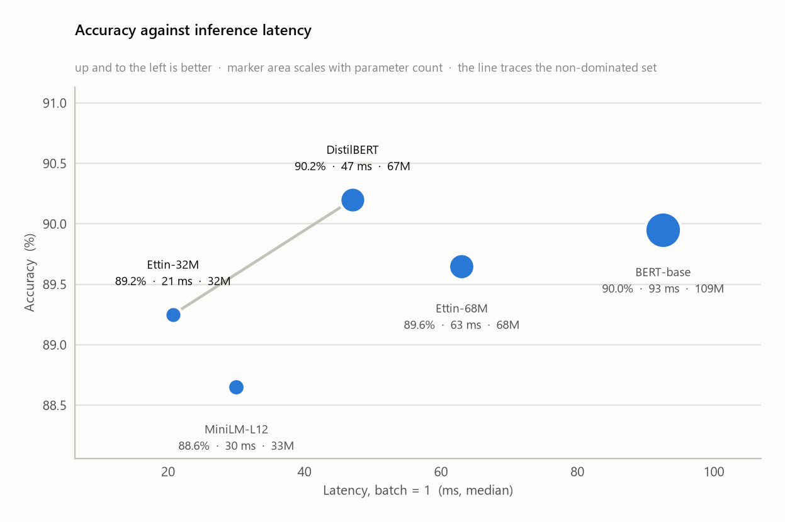
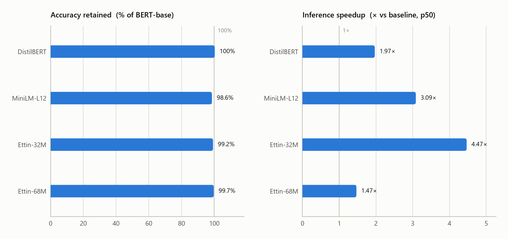
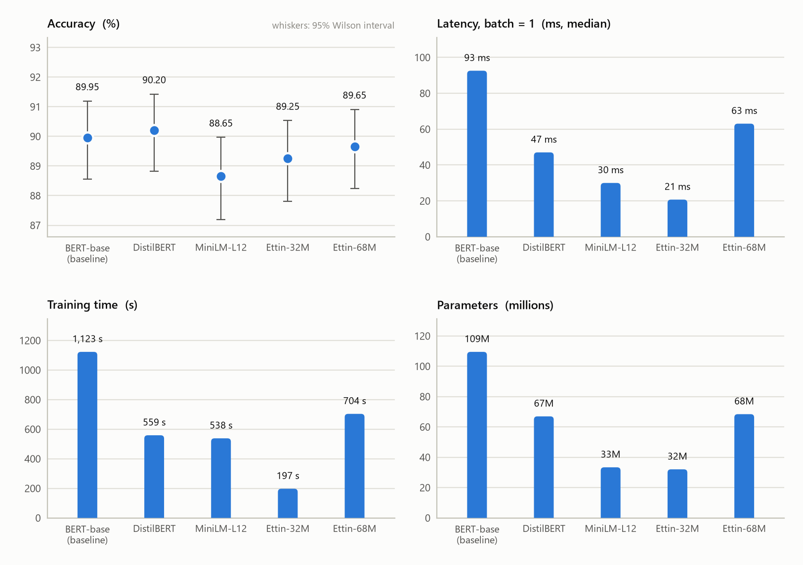

# Benchmark results

Task: **ag_news** (4 classes) · train 4000 / eval 2,000 examples · max_length 128 · seed 42

Hardware: **cpu** — AMD64 Family 26 Model 36 Stepping 0, AuthenticAMD · 24 logical cores · torch 2.13.0+cpu with 12 intra-op threads · transformers 4.57.6

_Generated by `report.py`. Absolute times are hardware-specific; the relative columns are what transfer to another machine._

## Headline

| Model                  | Accuracy | Train time | Inference (p50) |  Params |   Size |
| :--------------------- | -------: | ---------: | --------------: | ------: | -----: |
| BERT-base *(baseline)* |   89.95% |     19 min |         92.6 ms | 109.5 M | 418 MB |
| DistilBERT             |   90.20% |    9.3 min |         47.0 ms |  67.0 M | 255 MB |
| MiniLM-L12             |   88.65% |    9.0 min |         30.0 ms |  33.4 M | 127 MB |
| Ettin-32M              |   89.25% |    3.3 min |         20.7 ms |  32.0 M | 122 MB |
| Ettin-68M              |   89.65% |     12 min |         63.1 ms |  68.4 M | 261 MB |

## The answer

### DistilBERT

**DistilBERT** preserves **100.3%** of BERT-base's accuracy (Δ = +0.25 pp, 95% CI [-0.45, +0.95] pp; McNemar p = 0.583) while cutting p50 inference latency by **49.2%** (1.97× faster), training time by 50.2%, parameters by 38.8%, on-disk size by 38.8%.

The gap is **not** statistically detectable at this eval size (n = 2,000, McNemar p = 0.583): 24 vs 29 discordant examples. That is 'no evidence of a difference', not 'no difference' — a larger eval set could still resolve one.

Exchange rate: **0.000 accuracy points per additional × of inference speed** (and 0.000 pp per 10% of parameters removed).

Parameter accounting: total -38.8%, but -49.7% once the embedding table is excluded. Embeddings are a lookup, not compute, so the non-embedding figure is the one that tracks latency.

### MiniLM-L12

**MiniLM-L12** preserves **98.6%** of BERT-base's accuracy (Δ = -1.30 pp, 95% CI [-2.20, -0.45] pp; McNemar p = 0.005) while cutting p50 inference latency by **67.6%** (3.09× faster), training time by 52.1%, parameters by 69.5%, on-disk size by 69.5%.

The gap is statistically detectable at this eval size (n = 2,000, McNemar p = 0.005): 53 examples only the baseline got right against 27 only this model got right.

Exchange rate: **0.623 accuracy points per additional × of inference speed** (and 0.187 pp per 10% of parameters removed).

Parameter accounting: total -69.5%, but -75.0% once the embedding table is excluded. Embeddings are a lookup, not compute, so the non-embedding figure is the one that tracks latency.

### Ettin-32M

**Ettin-32M** preserves **99.2%** of BERT-base's accuracy (Δ = -0.70 pp, 95% CI [-1.75, +0.30] pp; McNemar p = 0.215) while cutting p50 inference latency by **77.6%** (4.47× faster), training time by 82.4%, parameters by 70.7%, on-disk size by 70.7%.

The gap is **not** statistically detectable at this eval size (n = 2,000, McNemar p = 0.215): 62 vs 48 discordant examples. That is 'no evidence of a difference', not 'no difference' — a larger eval set could still resolve one.

Exchange rate: **0.202 accuracy points per additional × of inference speed** (and 0.099 pp per 10% of parameters removed). The accuracy loss behind it is not statistically detectable, so neither is this rate: it is not evidence that this model is a worse deal than one with a lower rate.

Parameter accounting: total -70.7%, but -85.2% once the embedding table is excluded. Embeddings are a lookup, not compute, so the non-embedding figure is the one that tracks latency.

### Ettin-68M

**Ettin-68M** preserves **99.7%** of BERT-base's accuracy (Δ = -0.30 pp, 95% CI [-1.20, +0.60] pp; McNemar p = 0.594) while cutting p50 inference latency by **31.9%** (1.47× faster), training time by 37.3%, parameters by 37.5%, on-disk size by 37.5%.

The gap is **not** statistically detectable at this eval size (n = 2,000, McNemar p = 0.594): 47 vs 41 discordant examples. That is 'no evidence of a difference', not 'no difference' — a larger eval set could still resolve one.

Exchange rate: **0.641 accuracy points per additional × of inference speed** (and 0.080 pp per 10% of parameters removed). The accuracy loss behind it is not statistically detectable, so neither is this rate: it is not evidence that this model is a worse deal than one with a lower rate.

Parameter accounting: total -37.5%, but -50.2% once the embedding table is excluded. Embeddings are a lookup, not compute, so the non-embedding figure is the one that tracks latency.

## Verdict

On this task and this hardware, **Ettin-32M** is the pick: 99.2% of BERT-base's accuracy at 4.47× the inference speed. Basis: fastest model with no statistically detectable accuracy gap (α = 0.05).

Pareto frontier (accuracy ↑, latency ↓): **DistilBERT, Ettin-32M**. The frontier is drawn on point estimates, so each model off it is tested against the models that dominate it:

- **BERT-base**, dominated by DistilBERT (accuracy McNemar p = 0.583): beaten on latency; its accuracy deficit is not statistically detectable, so on accuracy it is not shown to be worse.
- **MiniLM-L12**, dominated by Ettin-32M (accuracy McNemar p = 0.294): beaten on latency; its accuracy deficit is not statistically detectable, so on accuracy it is not shown to be worse.
- **Ettin-68M**, dominated by DistilBERT (accuracy McNemar p = 0.294): beaten on latency; its accuracy deficit is not statistically detectable, so on accuracy it is not shown to be worse.

## Detail

| Model      | Acc (%) |     Acc 95% CI | F1 macro (%) | p50 (ms) | p95 (ms) | p50 range over rounds | Throughput (ex/s) | Non-emb. params (M) | On frontier |
| :--------- | ------: | -------------: | -----------: | -------: | -------: | --------------------: | ----------------: | ------------------: | ----------: |
| BERT-base  |   89.95 | [88.55, 91.19] |        90.03 |     92.6 |     98.4 |             84.4–93.0 |              16.0 |                85.6 |          no |
| DistilBERT |   90.20 | [88.82, 91.43] |        90.25 |     47.0 |     51.4 |             46.4–47.6 |              31.7 |                43.1 |         yes |
| MiniLM-L12 |   88.65 | [87.19, 89.97] |        88.74 |     30.0 |     34.6 |             29.4–31.2 |              52.7 |                21.4 |          no |
| Ettin-32M  |   89.25 | [87.82, 90.53] |        89.34 |     20.7 |     23.8 |             20.3–21.6 |              76.4 |                12.7 |         yes |
| Ettin-68M  |   89.65 | [88.24, 90.91] |        89.73 |     63.1 |     67.9 |             61.6–64.2 |              24.1 |                42.6 |          no |

## Relative to the baseline

| Model      | Acc retained | Δ acc (pp) |  Δ 95% CI (pp) | McNemar p | Speedup | Train speedup | Params cut | pp / extra × |
| :--------- | -----------: | ---------: | -------------: | --------: | ------: | ------------: | ---------: | -----------: |
| DistilBERT |      100.28% |      +0.25 | [-0.45, +0.95] |     0.583 |   1.97× |         2.01× |      38.8% |        0.000 |
| MiniLM-L12 |       98.55% |      -1.30 | [-2.20, -0.45] |     0.005 |   3.09× |         2.09× |      69.5% |        0.623 |
| Ettin-32M  |       99.22% |      -0.70 | [-1.75, +0.30] |     0.215 |   4.47× |         5.69× |      70.7% |        0.202 |
| Ettin-68M  |       99.67% |      -0.30 | [-1.20, +0.60] |     0.594 |   1.47× |         1.60× |      37.5% |        0.641 |

`pp / extra ×` is the exchange rate: accuracy points lost for each additional multiple of inference speed. Lower is a better deal; a blank means the model was not faster than the baseline. Compare rates only between models whose accuracy loss is significant: a rate built on a loss inside the noise is itself noise.

## Seed-to-seed variation

Single seed. Fine-tuning variance on a run this size is typically a few tenths of a point, which is the same order as the smaller gaps above — so run `run_benchmark.py --seeds 42 43 44` before treating a sub-half-point difference as real.

## Figures

## Method notes

- Every model trains and is evaluated on byte-identical subsets (shuffle seeded, then `select`), which is what licenses the paired tests.
- Training time excludes evaluation: `eval_strategy="no"` during `train.py`.
- Latency is measured after warmup passes, under `torch.inference_mode()`, with fixed-length padding so every model sees identically shaped tensors.
- Warmup has both a count and a duration floor. A fixed iteration count warms a fast model for less wall-clock time than a slow one, which on CPU biases the comparison toward whichever model warmed least.
- Timings come from 3 interleaved round(s): every round times every model, with the starting position rotated so no model is always measured first. The reported figure is the median across rounds; the detail table shows the range. Measuring one model to completion before starting the next would make machine drift indistinguishable from architecture.
- Throughput times each batch individually and reports the median, plus a drift ratio (last third over first third). Drift near 1 means the machine held its speed within that measurement.
- Before the first model is timed, `evaluate.py` loads the CPU until its speed stops changing. A processor at idle is well below its sustained clock, so without this the first model in the list is measured on a slower machine than the rest — a bias no per-model warmup can reach.
- A fixed calibration matmul is then timed beside every model's measurement. Comparing it across models is the only way to know they met the same machine: drift cannot see between models, only within one.
- Each model uses its own recommended learning rate (see `config.py`); pass `--uniform-lr` to hold it constant instead.
- News topic classification, 4 balanced classes. Headline + short description, so 128 tokens covers ~99% of examples: the accuracy comparison is not confounded by truncation.
- Truncation at max_length 128: 0.4% of eval examples.
